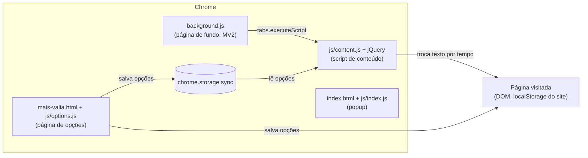
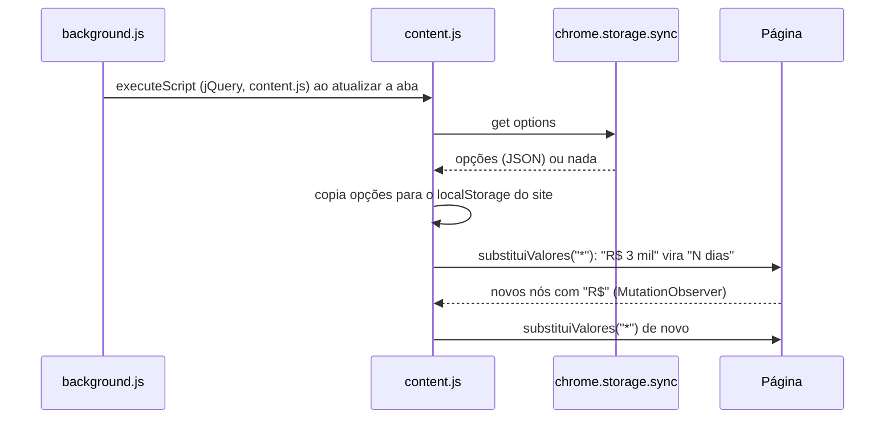

# Arquitetura

> Descreve o que **é** hoje (2026-11-18, na adoção do fluxo), não o que deveria ser. Mantida a cada ADR e a cada tarefa que muda a estrutura.

## Visão geral

O manifesto também declara um `content_scripts` que injeta `js/modules.js`, `js/modulesTest.js` e `js/index.js` em todas as páginas: os dois primeiros **não existem** (defeito, roadmap).

## Componentes

| Componente | Tecnologia | Responsabilidade |
|---|---|---|
| `extension/manifest.json` | Manifest V2 | Permissões (`activeTab`, `tabs`, `storage`, `<all_urls>`), página de fundo, popup, página de opções |
| `extension/background.js` | JS, API `chrome.*` | Injeta jQuery e `content.js` na aba quando ela atualiza; alterna ligado/desligado (RF20, RF21) |
| `extension/js/content.js` | JS + jQuery 3.2.1 | Procura valores em reais no DOM, calcula o tempo e troca o texto; observa mudanças do DOM (RF01–RF08, RF12, RF13) |
| `extension/js/options.js` + `mais-valia.html` | JS, DOM | Formulário de salário e horas; grava no `localStorage` e no `chrome.storage.sync` (RF10, RF11) |
| `extension/index.html` + `js/index.js` | HTML, JS | Popup com radios Ligado/Desligado (sem lógica) |
| `extension/src/modules.js` | JS (CommonJS) | Cópia da lógica de conversão em funções, **não carregada pela extensão**; `module.exports` chama as funções em vez de exportá-las |
| `unit-test/` | Jest 29 | Único teste (`expect(1).toEqual(1)`); não alcança o código real |

## Fluxos principais

### Conversão de uma página (RF01–RF07, RF12, RF13)

### Configuração (RF10, RF11)

O usuário preenche a página de opções; ao salvar, os valores vão para o `localStorage` da página de opções e o objeto inteiro desse `localStorage` vai para `chrome.storage.sync` como JSON (`options`).

## Decisões técnicas

| Tema | Decisão | Motivo |
|---|---|---|
| Plataforma | Extensão do Chrome, Manifest V2, JS puro, sem bundler | Herdada de 2020; motivo não registrado ([ADR 0001](adr/0001-adocao-do-fluxo-e-decisoes-herdadas.md)) |
| DOM | jQuery 3.2.1 slim versionado | Herdada; motivo não registrado |
| Persistência | `localStorage` + `chrome.storage.sync` | Herdada; ver [modelo de dados](modelo-de-dados.md) |
| Testes | Jest em `unit-test/`, fora de `extension/` | Herdada; hoje sem efeito |

## Ambientes

| Ambiente | Como roda |
|---|---|
| Local | `chrome://extensions` → modo desenvolvedor → *Load unpacked* → `extension/` |
| Testes | `cd unit-test && npm install && npm test` |
| Produção | Não existe (publicação na Chrome Web Store: RF30) |
